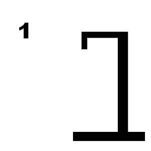

# Galgje – Git Collaboration

**Team:** <Teamnaam>  
**Spelvolgorde & contact:**
1. <Aiden 1> – <aiden.dax@gmail.com>
2. <Naam 2> – <email2@example.com>
3. <Naam 3> – <email3@example.com>
4. <Naam 4> – <email4@example.com>

---

## Woordraster
<!-- Pas het aantal kolommen aan aan de woordlengte -->
| . | . | . | . | . | . | . | . | . | . | . | . | . |
| - | - | - | - | - | - | - | - | - | - | - | - | - |
| 1 | 2 | 3 | 4 | 5 | 6 | 7 | 8 | 9 | 10 | 11 | 12 | 13 |

## Status

---

## Beurtenlog
- beurt1: <Aiden> gokt "a"
- beurt2: ...
